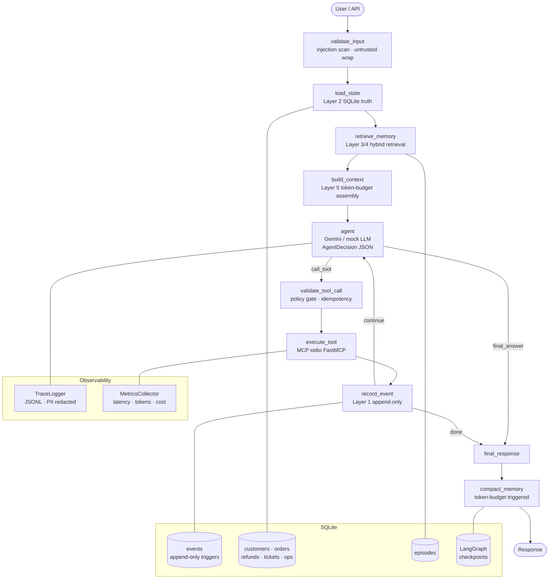

# Long-Running Customer Support Agent

> **Stateful, multi-turn (30+ turns) e-commerce customer-support agent demo**
> built with LangGraph · FastMCP `stdio` · SQLite · FastAPI · Streamlit

[](https://github.com/tagore19/long-running-support-agent/actions/workflows/ci.yml)

---

## What This Project Does

This agent handles real e-commerce support workflows — order lookups, refund requests, complaint escalation to human agents — across arbitrarily long conversations (tested to 32+ turns) while guaranteeing:

| Guarantee | How |
|---|---|
| **LLM never decides policy** | All refund limits, delivery checks, and ownership rules are enforced in deterministic Python (`src/policies/`) and inside SQLite transactions |
| **No duplicate refunds** | Idempotency keys stored in `tool_operations`; re-issuing the same key returns the same result without a second DB write |
| **Order ownership enforced** | Refund and order tools verify that the requested order belongs to the supplied `customer_id` before returning or mutating state |
| **No prompt injection** | All untrusted inputs (user message, order notes, documents, images) are HTML-escaped and wrapped in explicit `<*_untrusted_data>` delimiters before the prompt builder sees them |
| **No PII in logs** | Regex + allowlist redaction masks emails, phones, CPF/Aadhaar/CEP numbers, and secrets before every JSONL trace write |
| **Memory across 30+ turns** | 5-layer architecture: append-only event store → transactional SQLite → episodic episodes → hybrid TF-IDF retrieval → token-budget compaction |

---

## Core Engineering Priorities

1. **Framework, Ownership & Verifiability** — Every component is deterministic, inspectable, typed, and tested; no black-box cloud state.
2. **Zero-Friction Handover & Reproducibility** — Clone, copy `.env.example`, install, run. No secrets needed for tests or evals (mock mode).
3. **LLM Is Untrusted for State & Policy** — The LLM only proposes `AgentDecision` JSON; all mutations go through Python policy gates and SQLite transactions.

---

## Architecture



> **MCP boundary:** `src/mcp_server/server.py` runs as a child process over `stdio`. `MCPToolClient` maintains a persistent worker with an async queue — no per-call subprocess spawn overhead.

---

## Setup — Local Python

```bash
# 1. Clone
git clone https://github.com/tagore19/long-running-support-agent.git
cd long-running-support-agent

# 2. Environment file
cp .env.example .env
# Edit .env — add your GEMINI_API_KEY for live LLM calls.
# Leave GEMINI_API_KEY blank / set LLM_PROVIDER=mock for fully offline mode.

# 3. Virtual environment (Python 3.11+)
python -m venv .venv
# Windows:
.\.venv\Scripts\Activate.ps1
# Linux / macOS:
source .venv/bin/activate

# 4. Install
pip install -e ".[dev]"

# 5. Seed SQLite data (idempotent — safe to re-run)
python -m scripts.seed_data
```

---

## One-Command Run

### Local

```bash
# FastAPI backend (REST + /docs swagger)
uvicorn src.api.app:app --reload --port 8000

# Streamlit operator & inspector UI (separate terminal)
streamlit run app.py
```

- API docs: <http://localhost:8000/docs>
- Streamlit UI: <http://localhost:8501>
- 32-turn deterministic demo: `python -m scripts.run_demo`

### Docker / docker-compose

```bash
cp .env.example .env     # fill in GEMINI_API_KEY (or leave blank for mock)
docker compose up --build
```

Both services (`api` on :8000, `ui` on :8501) share a persistent volume for SQLite and trace logs.  
The API healthcheck must pass before the UI container starts.

---

## Tests, Linter & Evals

```bash
# Linter (zero violations required)
ruff check .

# Full pytest suite (unit + memory + security + integration)
pytest -q

# 20 deterministic eval scenarios — improved mode (CI threshold: ≥ 0.90)
python -m evals.runner --mode improved --min-score 0.90 --output data/evals/improved.json

# Baseline run (sliding-window, no guardrails — intentionally weaker)
python -m evals.runner --mode baseline --output data/evals/baseline.json

# Generate Markdown + JSON before/after comparison report
python -m evals.report \
    --baseline data/evals/baseline.json \
    --improved data/evals/improved.json \
    --out data/evals/before_after_report.md
```

The committed [before/after eval report](evals/reports/before-after.md) records the most recent checked-in run. Latency is machine- and run-dependent; the CI gate checks task success, policy violations, and duplicate actions.

---

## Data and Evaluation Scope

- `data/fixtures/olist_orders.json` is a compact, hand-authored Olist-shaped fixture used to exercise order and refund workflows; it is not the Kaggle Olist dataset.
- `data/fixtures/bitext_evals.json` contains support-intent examples in a Bitext-style format; it is not a downloaded Bitext corpus.
- `data/fixtures/long_conversations.json` contains an authored 32-turn stress conversation; it is not a LoCoMo or Multi-Session Chat sample.
- The fixed 20-case evaluation set is project-authored and deterministic. It validates framework behavior and guardrails, not model accuracy or performance on an external benchmark.

---

## Deployment — Streamlit Community Cloud

1. Sign in at <https://share.streamlit.io> and deploy `tagore19/long-running-support-agent`.
2. Set the main file to `app.py`. Streamlit Cloud installs dependencies from the committed `requirements.txt`.
3. The app runs in offline mock mode without secrets. To enable Gemini, add `GEMINI_API_KEY` to Streamlit Cloud's Secrets; the UI maps it to the process environment for the existing settings layer. Set `LLM_PROVIDER = "gemini"` and `LLM_MODE = "live"` there if desired. Locally, use environment variables or `.env`. Never commit credentials.
4. Verify the app with the valid-refund, expired-window, and 32-turn stress-test presets.

> **Persistence limitation:** Streamlit Community Cloud does not provide durable local disk storage across rebuilds/restarts. The demo database and conversation history can be reset. Do not use this deployment for real customer data or financial transactions.

### Local Demo Fallback

```bash
python -m scripts.run_demo      # runs a deterministic 32-turn transcript
# To submit a recording, capture the Streamlit UI or this command with your preferred recorder.
```

---

## Rollback Steps

### Code rollback

```bash
# Tag releases before shipping
git tag v1.0.0 && git push origin v1.0.0

# Revert to a previous tag
git checkout v0.9.0
pip install -e ".[dev]"
```

### Database rollback

```bash
# Back up before seeding or migration
cp data/app.db data/app.db.bak

# Restore from backup
cp data/app.db.bak data/app.db

# Or wipe and re-seed from scratch (destroys all conversation history)
python -m scripts.seed_data --reset
```

### LangGraph checkpoint rollback

```bash
# Checkpoints are stored in data/checkpoints.db.
# To reset conversation state for a specific thread_id, delete its rows:
sqlite3 data/checkpoints.db \
  "DELETE FROM checkpoints WHERE thread_id = 'thread-your-id';"
```

### Deployment rollback

```bash
# Docker: roll back to the previous image tag
docker compose down
docker compose up --build --no-cache   # or pin image: customer-support-agent:v0.9.0
```

---

## Repository Structure

```
├── app.py                      Streamlit operator & inspector UI
├── config/
│   └── business_rules.yaml     Policy rules, guardrails, token budgets
├── src/
│   ├── agent/
│   │   ├── graph.py            LangGraph StateGraph compilation + SupportAgentRunner
│   │   ├── nodes.py            All 9 LangGraph node functions
│   │   ├── routing.py          Conditional edge routing functions
│   │   └── state.py            AgentState TypedDict
│   ├── api/app.py              FastAPI REST endpoints + lifespan
│   ├── config.py               Pydantic v2 AppConfig, Settings, load_app_config()
│   ├── database/               SQLite connection, schema triggers, models, repositories
│   ├── llm.py                  LLMClient (Gemini / mock) + AgentDecision schema
│   ├── memory/                 5-layer memory schemas, retrieval, episodes, compaction
│   ├── mcp_server/             FastMCP stdio server + MCPToolClient
│   ├── observability/          TraceLogger, MetricsCollector, PII redaction
│   └── policies/               Deterministic refund policy, auth, injection detection
├── evals/
│   ├── dataset.json            20 deterministic evaluation scenarios
│   ├── runner.py               Threshold-gated eval runner (--mode/--min-score/--output)
│   └── report.py               Markdown/JSON before-after comparison report
├── scripts/
│   ├── seed_data.py            Idempotent SQLite seeder (12 customers, 35 orders)
│   └── run_demo.py             32-turn deterministic demo script
├── tests/
│   ├── unit/                   Policy, database, foundation tests
│   ├── memory/                 5-layer memory, compaction, retrieval tests
│   ├── security/               PII redaction, injection, tracing tests
│   └── integration/            End-to-end LangGraph + MCP + FastAPI tests
├── Dockerfile                  Multi-stage build (builder → runtime, non-root)
├── docker-compose.yml          api (:8000) + ui (:8501) with shared persistent volume
├── .github/workflows/ci.yml   Ruff → pytest → evals gate on every push/PR
├── DESIGN.md                   Architecture decisions and design rationale
└── AI_USAGE.md                 AI tool usage log and three concrete AI mistakes caught
```

---

## Known Limitations

- **SQLite concurrency:** SQLite's `BEGIN IMMEDIATE` transactions prevent double-write races at the row level but are not suitable for high-fan-out multi-process deployments. Migrate to PostgreSQL for production scale.
- **No end-user authentication:** This is a public demo with synthetic fixtures. The API accepts a caller-supplied `customer_id`, and the UI lets visitors select demo customers. Order ownership checks do not authenticate a real customer; do not connect real accounts or data.
- **Stdio MCP on Windows:** Each MCP server starts as a child process over `stdio`. On Windows, asyncio subprocess handling has additional overhead; the persistent worker queue in `MCPToolClient` mitigates this but does not eliminate it.
- **`aiosqlite` version pin:** `langgraph-checkpoint-sqlite` requires `aiosqlite < 0.22` (pinned to `0.21.x`). Upgrading LangGraph may lift this constraint.
- **In-memory TF-IDF:** `HybridMemoryRetriever` builds a TF-IDF matrix on the fly per query over all episodes for the customer. For customers with thousands of episodes, switch to a vector DB (Chroma, pgvector).
- **Mock LLM:** The offline mock returns deterministic canned responses; it does not test semantic model understanding. All policy, memory, and tool execution tests are deterministic regardless of LLM.

---

## What I'd Do Next

1. **Persistent vector store** — Replace in-memory TF-IDF with Chroma or pgvector for scalable episode retrieval.
2. **PostgreSQL backend** — Migrate from SQLite to PostgreSQL for multi-process deployment and HA.
3. **Streaming responses** — Add Server-Sent Events from FastAPI + Streamlit's `st.write_stream` for real-time token streaming.
4. **Human-in-the-loop dashboard** — A separate operator view that shows pending escalation tickets and lets a human agent inject a resolution back into the conversation thread.
5. **Webhook delivery** — Push refund confirmations and ticket updates to customer email/SMS via a lightweight notification sidecar.
6. **Multi-language support** — Route through a lightweight detection step and pass language hint to the system prompt.
7. **LangSmith / OpenTelemetry tracing** — Export JSONL traces to LangSmith or an OTEL collector for production observability.
8. **Canary / shadow evals in CI** — Run the 20-scenario suite against the shadow deployment before promoting to production.
